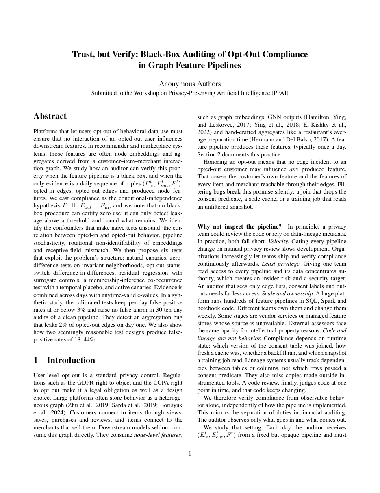
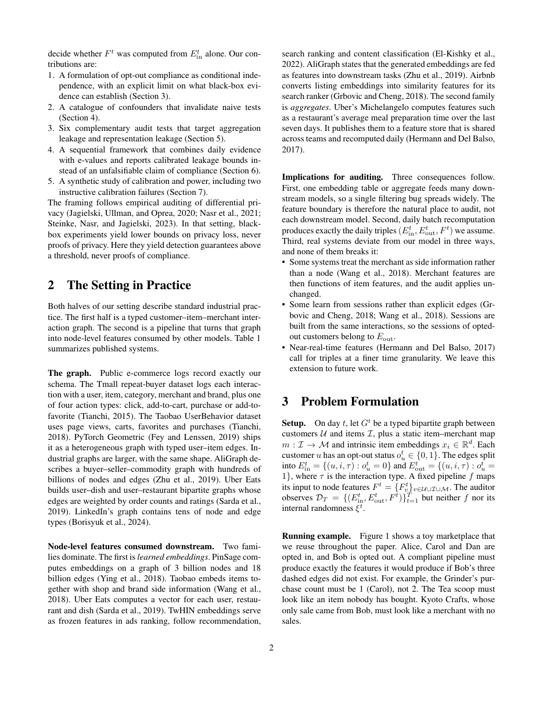
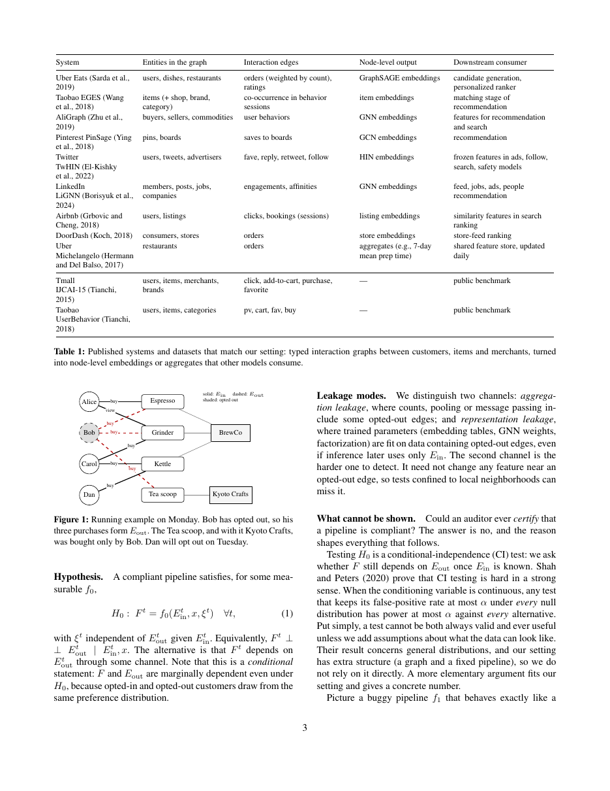
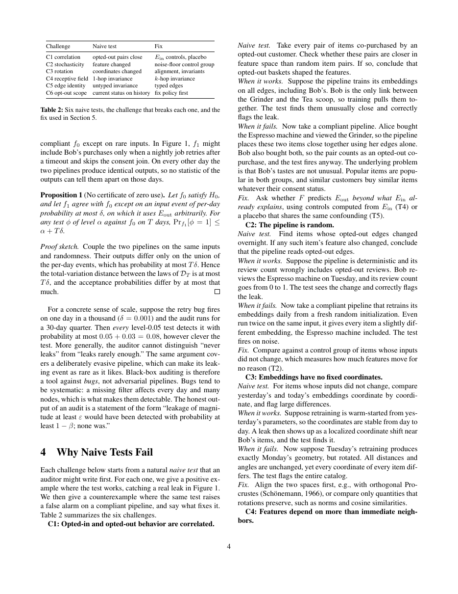
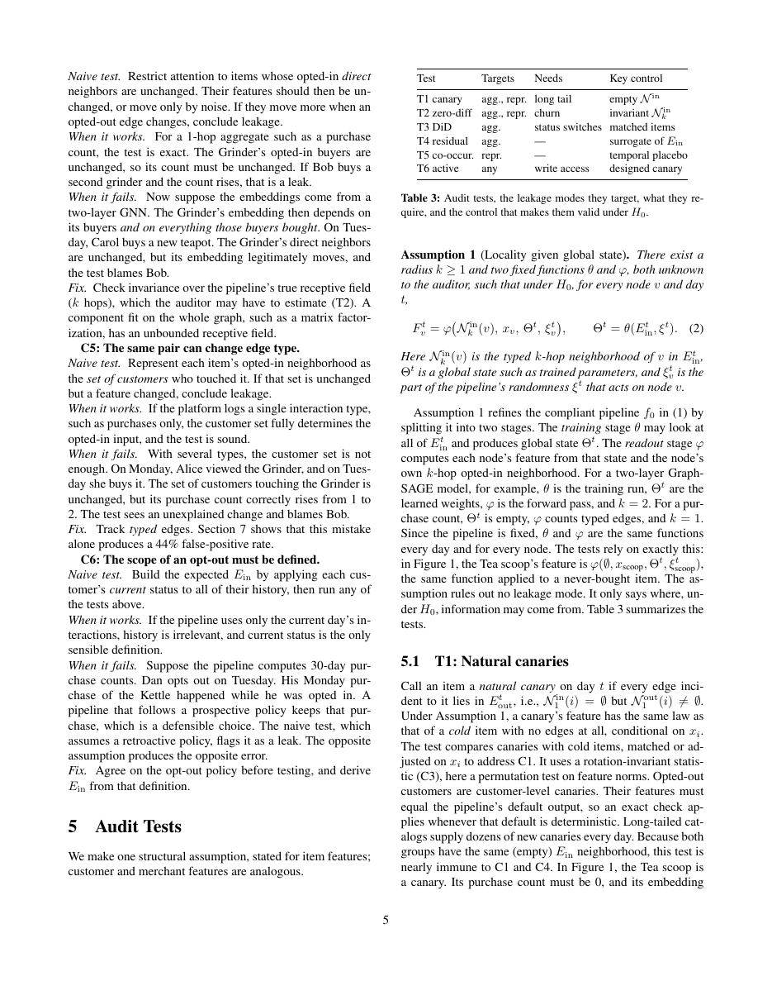
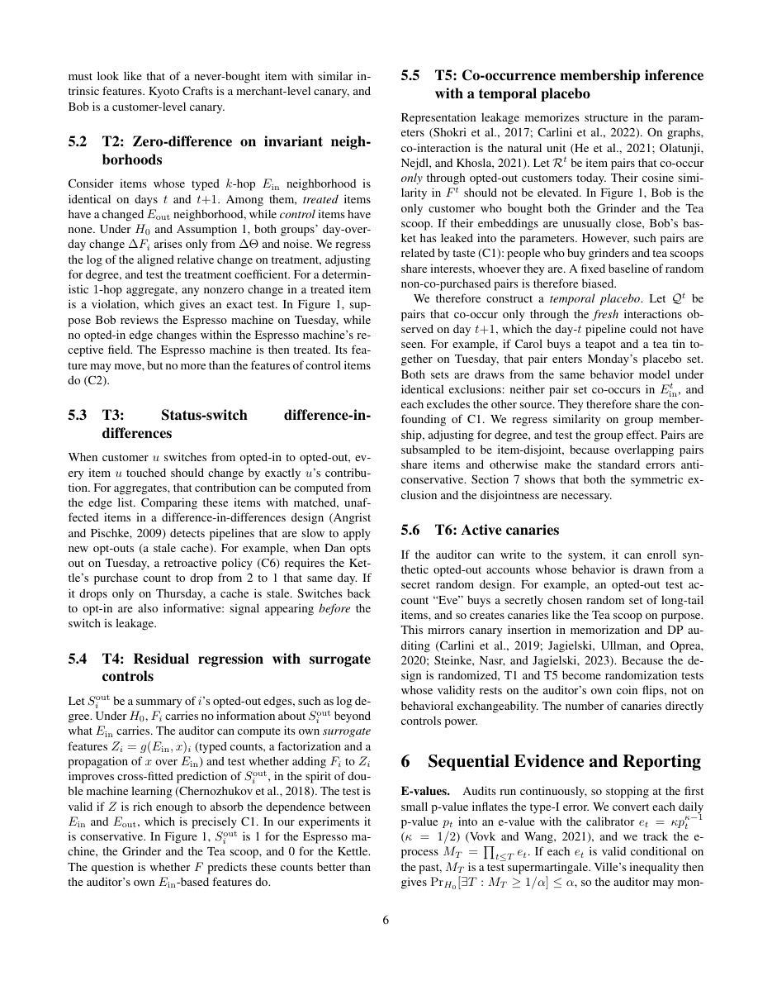
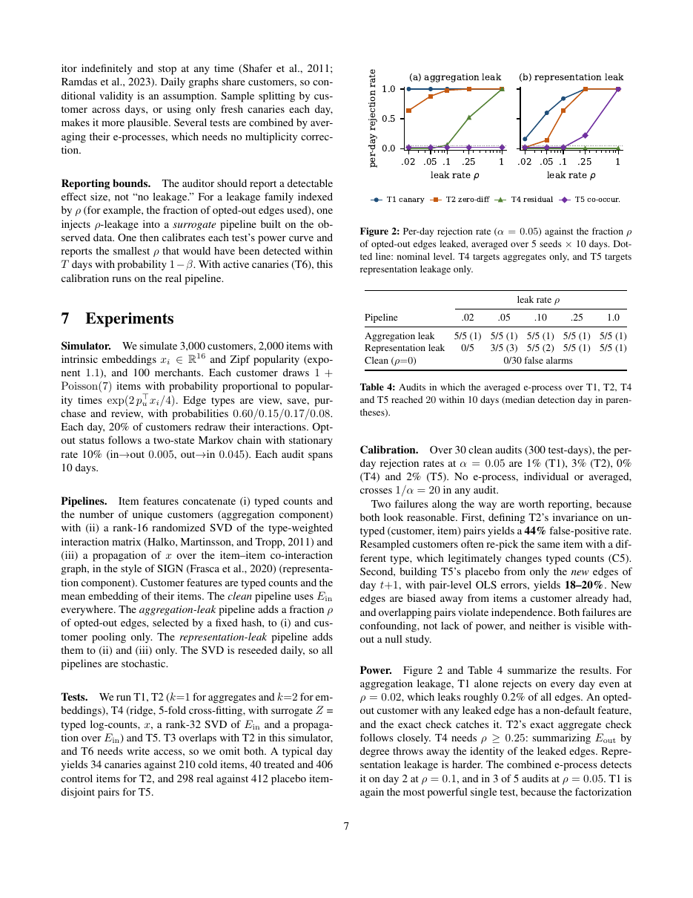
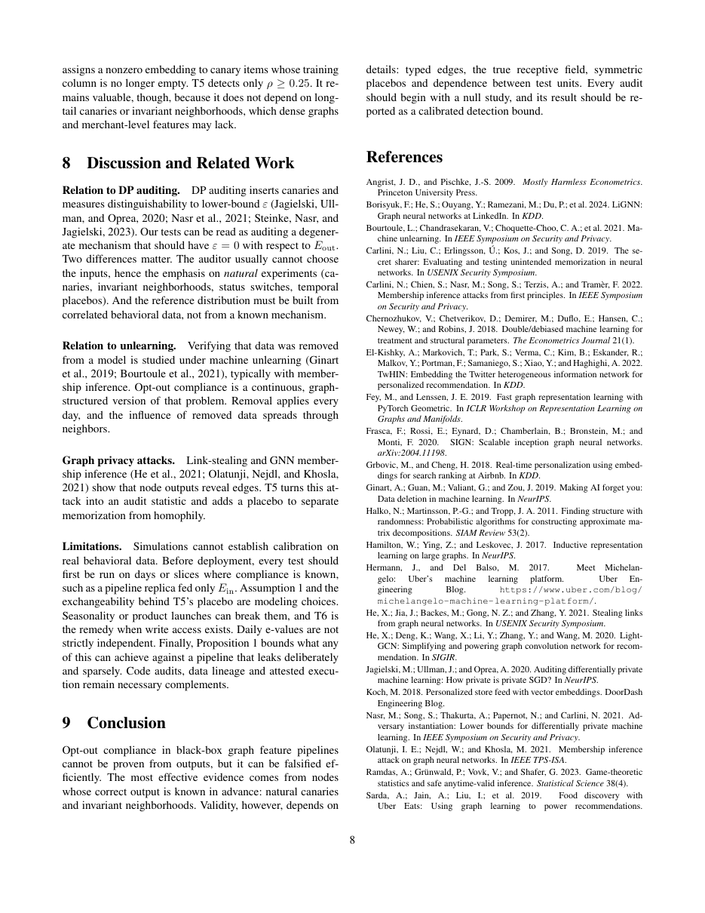
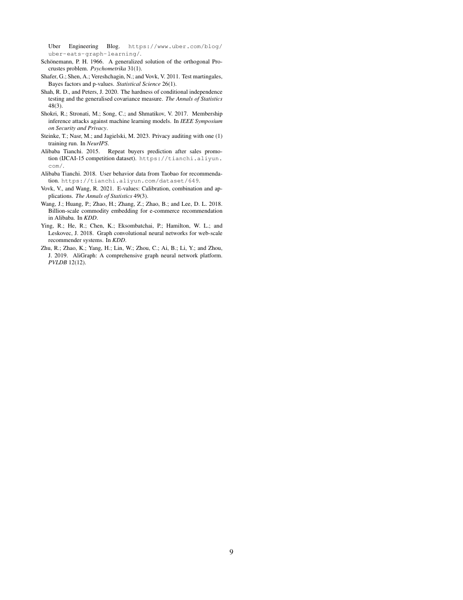

# Trust, but Verify: Black-Box Auditing of Opt-Out Compliance in Graph Feature Pipelines

**[Download the paper (PDF)](main.pdf)** · PPAI-style (AAAI two-column) workshop draft

The pages below are rendered from `main.pdf`. To refresh them after editing, run `./build.sh`.











---

## Repository layout

- `main.tex`: paper source (compile with pdfLaTeX; Overleaf main file)
- `main.pdf`: compiled paper
- `pages/`: page images shown in this README
- `power.pdf`: Figure (power curves)
- `sim/audit_sim.py`: synthetic graph, clean / leaking pipelines, audit tests T1, T2, T4, T5
- `sim/analyze.py`: summary statistics and the power figure
- `build.sh`: compiles the paper and regenerates `pages/`

## Reproduce the experiments

```
cd sim
python3 audit_sim.py 0,1,2,3,4 main.json
python3 -c "import audit_sim as a, numpy as np, json; json.dump([dict(seed=s, p=a.run(s,'clean',0.0)[0], meta={}) for s in range(100,130)], open('null.json','w'))"
python3 analyze.py
```
